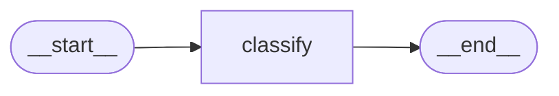

# Customer Support Agent

A production-shaped customer-support triage agent built with **LangGraph JS**, running entirely
against a **local MLX model** on Apple Silicon. No cloud inference, no API keys to a model provider.

This is a learning project built one node at a time, so the repo is deliberately small and
each commit adds a single concept.

> **Status: milestone 1.** The graph has one node (classification) and runs end to end.
> Retrieval, routing, human approval and the HTTP layer are not built yet. See [Roadmap](#roadmap).

---

## Requirements

| | |
|---|---|
| Node.js | **24+** (uses native TypeScript execution and `--env-file`) |
| Local LLM server | [oMLX](https://omlx.app) or any OpenAI-compatible endpoint |
| Model | `gpt-oss-20b-MXFP4-Q8` (any tool-calling MLX model works) |
| Hardware | Apple Silicon with enough unified memory for a 20B model |

There is **no build step**. Node runs the TypeScript directly.

---

## Setup

```bash
git clone git@github.com:adilJamshad/customer-support-agent.git
cd customer-support-agent
npm install
cp .env.example .env     # then set OMLX_API_KEY
```

Start your local model server:

```bash
omlx start               # serves an OpenAI-compatible API on :8000
```

Verify the stack — chat, tool calling, and structured output:

```bash
npm run smoke
```

---

## Usage

```bash
npm start -- --list              # list the fixture tickets
npm start -- T-1018              # classify one ticket
npm start -- T-1018 --reasoning  # also print the model's chain of thought
npm start -- --all               # classify all 20 fixtures
npm run typecheck                # tsc --noEmit (Node strips types, it does not check them)
```

Example:

```
T-1018  Billing page errors when I click upgrade
  billing   high     frustrated
  User reports a payment profile missing error blocking upgrade, no workaround.
  4949ms  667 tokens
  reasoning: Category: billing (payment profile missing). It's a technical error
  but it's billing. Urgency high because blocked.
```

---

## How it works



One node today. The machinery worth understanding is inside it:

```
graph.invoke({ ticket })
  │
  ├─ channels initialised from AgentStateSchema
  ├─ classifyNode(state)
  │    ├─ formatTicket(ticket)
  │    ├─ model call, schema bound as a TOOL (not response_format)
  │    ├─ extract reasoning_content + token usage from the raw message
  │    └─ return a PARTIAL state update
  ├─ LangGraph merges each key with that channel's reducer
  └─ final state
```

### State channels

State is a zod schema. Each field is a channel with its own merge behaviour — this is the
part that bites people:

| Channel | Reducer | Why |
|---|---|---|
| `ticket` | overwrite | Set once at entry |
| `messages` | **append** | Conversation accumulates (unused until drafting exists) |
| `classification` | overwrite | Latest classification wins |
| `trace` | **append** | Per-node latency, tokens and reasoning; nothing is lost |

`trace` is the audit log. Every node appends one event, so the model's reasoning becomes part of
graph state rather than a log line that scrolls away.

### Failure behaviour

If the model call throws, the node returns a valid `other` / `medium` classification with the
error text in `rationale` and still appends a trace event. A triage system that drops tickets
when the model hiccups is worse than one that admits uncertainty.

---

## Project structure

```
src/
  config.ts            zod-validated env, fails at boot not at first use
  logger.ts            pino -> JSONL file + console
  model.ts             ChatOpenAI factory, structured-output helper, extractors
  smoke.ts             verifies chat / tool calling / structured output
  index.ts             CLI (parseArgs, no dependency)
  domain/schemas.ts    Ticket + Classification schemas
  fixtures/            20 seed tickets, loaded through schema validation
  graph/
    state.ts           channels and reducers
    index.ts           StateGraph assembly
    nodes/classify.ts  the only node so far
```

---

## Notes on running LangChain against a local model

Three things that only surface once the endpoint is not OpenAI. They cost real debugging time,
so they are written down here:

**1. `response_format` is accepted but does not work.** oMLX returns `content: null` with
`finish_reason: "stop"` for both `json_schema` and `json_object` — it reports success while
producing nothing. Structured output must therefore go through tool calling:

```ts
model.withStructuredOutput(schema, { method: "functionCalling", includeRaw: true })
```

This is pinned centrally in `createStructuredModel` so no call site can forget it. An
OpenAI-*compatible* endpoint matches the API's shape, not necessarily its semantics — probe
every feature.

**2. `MessagesZodState` throws on zod 4.6.7**, despite that version being inside LangGraph's
declared peer range (`^4.2.0`). The messages channel is defined directly with
`messagesStateReducer` instead. Version ranges are claims, not guarantees.

**3. `reasoning_content` survives.** gpt-oss returns its chain of thought in a non-standard
field, and LangChain preserves it in `additional_kwargs`. `includeRaw: true` is what makes it
reachable — the parsed object alone discards it.

---

## Known classification issues

Found by running all 20 fixtures. Unfixed, and kept visible on purpose — they are three
different *kinds* of problem:

| Ticket | Output | Expected | Kind |
|---|---|---|---|
| T-1007 cancel account | urgency `high` | low / medium | **Prompt** — saw "cancel", inflated urgency |
| T-1014 security report | sentiment `frustrated` | neutral | **Prompt** — severity bled into sentiment |
| T-1019 DPA request | category `other` | legal / compliance | **Schema** — no such category exists |

The first two are fixable by prompting. The third is not fixable by any prompt.

"Expected" above is a human judgement, not a measurement — which is why evals come before
prompt fixes.

---

## Roadmap

- [x] Scaffolding, config, logging, model binding
- [x] `classify` node, zod state, trace channel
- [ ] Evals — labelled fixtures and a scorer, so prompt changes are measured
- [ ] `retrieve` node — customer history and KB lookup via a tool loop
- [ ] `decide` — first conditional edge
- [ ] Human approval — checkpointer plus graph interrupt
- [ ] HTTP layer with streaming
- [ ] Optional LangSmith tracing (env-gated; local logging always on)

---

## Configuration

All options are validated at startup. See `.env.example`.

| Variable | Default | Purpose |
|---|---|---|
| `OMLX_BASE_URL` | `http://127.0.0.1:8000/v1` | Local model endpoint |
| `OMLX_API_KEY` | — | Required |
| `OMLX_MODEL` | `gpt-oss-20b-MXFP4-Q8` | Model id as the server reports it |
| `OMLX_TEMPERATURE` | `0.2` | Default sampling; classification overrides to `0` |
| `REQUEST_TIMEOUT_MS` | `120000` | Local models are slow when cold |
| `MAX_RETRIES` | `2` | Handled by the SDK |
| `LOG_LEVEL` / `LOG_PRETTY` | `info` / `false` | `LOG_PRETTY=true` for readable console output |
| `LANGSMITH_TRACING` | `false` | Opt-in; requires `LANGSMITH_API_KEY` when enabled |
